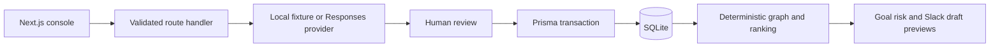

# Architecture

[Full design, diagrams, data model and cost assumptions](docs/architecture.md)

## Implemented assessment console

The meeting key hashes the normalized note and meeting date. The API reopens matching work and checks for a committed review inside the write transaction. Task edits use a revision check. Extraction runs retain provider, model, rule version, evidence, original proposals and review outcomes. Task updates retain changed field values and timestamps.

## Production proposal

Notion owns tasks, goals and notes. Slack handles alerts and approval interactions. A managed workflow handles confirmed writes, retries, signed Slack actions, provider receipts and a reconciliation schedule. Delivery and adoption metrics belong to the paid trial.

The model estimate in the build plan uses published rates. Workflow and monitoring are planning allowances. [Model pricing](https://developers.openai.com/api/docs/models/gpt-4o-mini)

## Record management

The SQLite catalog stores goals, team members, and deletion markers for seeded tasks. Task changes, dependency rewiring, ownership transfers, and catalog writes share a transaction with their audit events. A goal or owner can explicitly be unassigned. The graph is validated before edits or rewires are committed. A manual priority override is optional, and Automatic restores the deterministic ranking.

Local extraction records are hidden with a timestamp so duplicate detection can still read their meeting keys. Sample reset deletes only synthetic runs and the tasks they committed. Deleting or hiding logs is limited to local sample mode and preserves protected events and provider runs.
