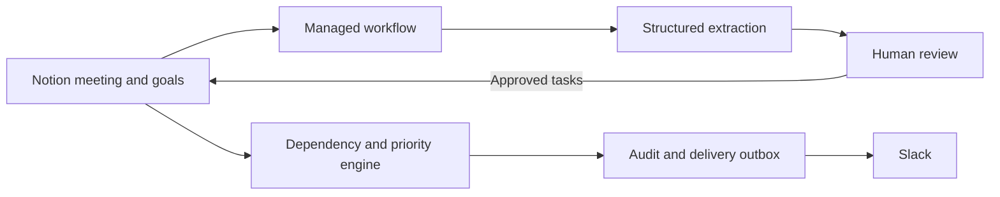

# Ops Brain | Just Sortd v1

**Scope.** Capture meeting commitments, verify owners and due dates through human review, and highlight work that threatens launch. Start with the four-task website launch chain. Keep the assessment reproducible with seeded data and a local review console.

| Area | v1 decision |
| --- | --- |
| Data | Goal has owner, date and weight. Task has owner, date, goal ID, prerequisite IDs and optional duration. A meeting key links extraction runs, rule versions, evidence and approval outcomes. |
| Buy vs build | Use Notion and Slack for team interaction, a small structured-output model for extraction, and managed workflow and storage. Build graph validation, ranking, review policy and alert deduplication. |
| Recovery | Keep the review editable after errors. Reject invalid graphs before writes. Commit tasks and review atomically. In production, retry transient outbox failures and reconcile against Notion. |
| Operating cost | 100 monthly runs × 2,000 input and 1,000 output tokens. At $0.15/$0.60 per million, model cost is $0.09. Allow $0–40 for managed scheduling, audit and monitoring. Existing seats assumed. |
| Assumptions | Mumbai timezone. Mon–Fri, 10:00–18:00 planning window. Goal weights 1–3. Calendar-day assessments until business calendars are configured. Alert impacted owners, then escalate unresolved goal risk to the goal lead. |

**Validation.** The demo proves review and persistence plus three-hop impact previews. In the paid trial, exercise a Notion slip and measure Slack deliveries against the 15-minute target. Track approval-without-edit rate, coverage, warning lead time and founder priority agreement during the pilot.
