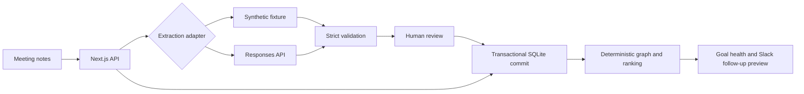
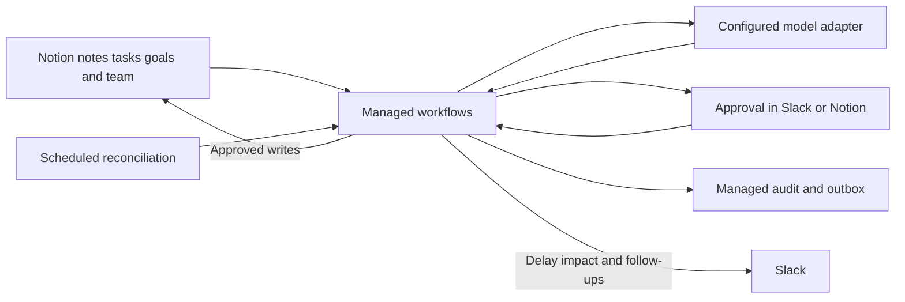
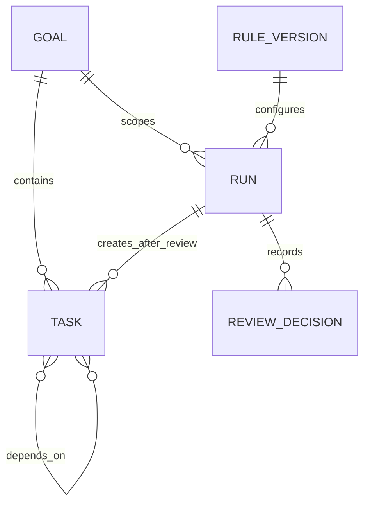

# Architecture and operating model

## Local assessment

## Proposed production v1

Google Workspace remains a meeting-note source where useful. Use a Notion intake record to link a document or paste its contents through the existing workflow. In production, authenticate Slack review actions, map reviewers to authorized identities, verify the reviewed proposal version, and compare the current Notion task revision before applying edits. Use event delivery where available plus periodic reconciliation. A dry-run agent can propose future recurring work using the same versioned policy and approval path.

## Data model

| Entity | Local storage and fields | Production authority |
| --- | --- | --- |
| Goal | Seeded ID, name, due date, importance, area | Notion Goals |
| Task | SQLite ID plus validated payload. Contains goal ID, title, owner, due date, dependency IDs, status, source evidence, and originating run ID | Notion Tasks and People relations |
| Run | SQLite UUID, created time, lifecycle state and payload. Contains notes, meeting date, model, configuration revision, original output, usage, cost estimate, edited proposals, and decisions | Managed audit store with access, retention, and deletion policy |
| Rule version | Append-only SQLite revision with prompt, model, rates, and ranking weights | Managed version table with reviewer access |
| Review and delivery | Review outcomes stored on the run. Follow-ups computed on demand | Identified approval events and delivery outbox with idempotency keys, attempts, outcomes, and timestamps |

## Buy versus build

| Decision | Reason |
| --- | --- |
| Use Notion and Slack | Keep familiar interfaces and one authoritative task store. |
| Use a managed workflow platform and managed audit store | Gain scheduled jobs, monitoring, and retry controls without running a custom queue or fleet. |
| Use a small structured-output model behind an adapter | Keep provider selection configurable. Compare multilingual extraction quality and cost on reviewed examples before changing models. |
| Build validation, dependency logic, ranking, and approval rules | These encode Just Sortd’s operational policy. Deterministic ranking is cheaper to run and easier to explain. |
| Use local SQLite and a custom console for the assessment | A single process and a local file make the full demo reproducible without paid infrastructure. |

## Ranking and failure handling

The score adds goal importance × goal weight, open descendant count × dependency weight, and bounded deadline urgency and forecast slip × deadline weight. Due date and stable task ID break ties. An open parent is a blocker. Forecasts preserve scheduled gaps between connected open tasks. A goal goes Off Track when a task forecast exceeds its deadline and At Risk when work slips inside the goal window or lacks required information.

- Missing owners or dates remain blank and flagged. The reviewer resolves them or rejects the proposal. Unsupported dates, duplicate IDs, cycles, and unresolved links are rejected before writes.
- The local API uses a 45-second provider timeout and records a recoverable failure. Retry creates a separately auditable run. A process interruption can leave a run marked running. Teams can retry from its meeting record. In production, expire stale leases and classify retryable quota, timeout, and transport errors.
- Approval and task creation share a transaction. Repeated commits for the same run return its committed state. Matching title and source evidence within a goal trigger a duplicate check.
- For production Slack delivery, deduplicate by event, recipient, and task. Retry transient failures with bounded backoff, escalate permanent failures, and reconcile Notion edits against the audit log. Use an end-to-end delivery timer for the paid-trial target.
- Prelaunch pilot reviews should capture both the original proposal and approved edits. Track language coverage, missed dependencies, and fabricated fields before expanding access.

## Monthly operating estimate

| Item | Assumption | Monthly estimate |
| --- | --- | --- |
| Model | 100 runs × 2,000 input and 1,000 output tokens. GPT-4o mini at $0.15 / $0.60 per million tokens. | $0.09 |
| Managed workflow runner | Budget allowance for scheduling, integration events, and retries. Confirm plan coverage during the pilot. | $0–30 |
| Managed audit storage and monitoring | Small event volume and short retention. | $0–10 |
| Existing Notion, Slack and Google Workspace | Assumes existing seats and compatible permissions. | $0 incremental |
| **Total** | Excludes taxes and any seat upgrades. | **$0.09–40.09** |

The local fixture costs $0 per run. Live cost is estimated from returned token counts and the rule version’s configured rates. [Model pricing](https://developers.openai.com/api/docs/models/gpt-4o-mini)
